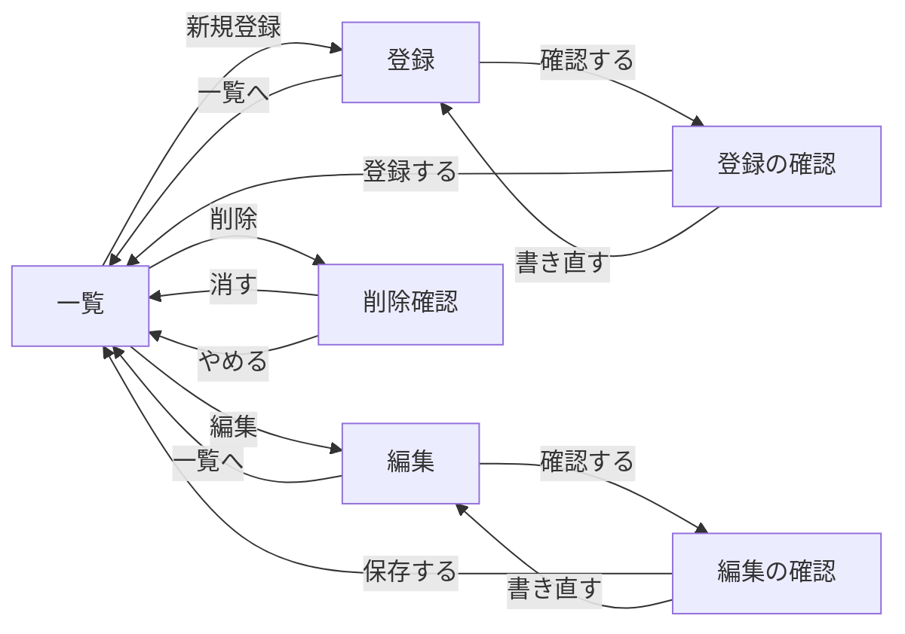

# やること管理アプリ 画面設計書

## 1. 目的・参照資料・対象範囲

この文書は、各画面に何を、どの順番で表示し、どの操作で次の画面へ移るかをまとめたものです。画面に出す見出し・項目名・ボタン名・案内文・エラー文（入力の問題を知らせる文）も定めます。

参照資料は、作業フォルダ直下の次の3つです。

| 資料 | この設計で参照する内容 |
|---|---|
| `handout_app_spec.md` | 第2章の保存項目、第3・4章の6画面、第5章の入力・表示・検索の決まり、第6章の見た目、第8章の対象外 |
| `requirements.md` | 第4〜8章の画面と操作、第10章の見た目、第12章の未確定事項 |
| `db-design.md` | 第3・4章の保存項目と保存するタイミング、第6・7章の表示との対応、第8章の未確定事項 |

設計する画面は、第2章に示す**6画面だけ**です。既存のトップページ `/` はそのまま使い、この設計の対象に含めません。完了専用画面、検索専用画面、見つからない場合の専用画面などは追加しません。

資料に指定がない見出しや配置の具体化は **【設計上の補足】** と記します。元資料で明示的に未確定とされている点については、**【設計案・未確定】** として案を示し、元から決まっていた条件と区別します。引き継ぐ未確定事項は第12章にまとめます。

この作業で作成・更新するファイルは `screen-design.md` だけです。参照資料やアプリのファイルは変更しません。

## 2. 画面一覧（6画面）

以下のアドレスは、`http://localhost:8081` などの接続先に続く部分だけを記載します。`localhost` は、アプリを動かす自分のパソコンを表します。`{id}` は、対象のやること1件を見分ける番号に置き換えます。たとえば番号が12なら、編集のアドレスは `/todos/12/edit` です。

**【資料の相違・未確定】** 接続先は、`handout_app_spec.md` 第3章では `http://localhost:8080`、`requirements.md` 第4章では `http://localhost:8081` と記載されています。末尾の8080・8081はポート番号（同じパソコンの中で接続先を区別する番号）です。どちらを使うかはこの設計書で確定せず、第12章に引き継ぎます。6画面のアドレスのうち `/todos` から始まる部分は、両資料で一致しています。

**【設計上の補足】** S01〜S06は、この文書で画面を見分けるための番号です。画面には表示しません。画面の見出しは、資料の画面名をそのまま使います。

| 画面番号 | 画面名・画面に出す見出し | アドレス | 役割 |
|---|---|---|---|
| S01 | 一覧 | `/todos` | やることを並べ、検索・並び替え・各操作を始める |
| S02 | 登録 | `/todos/new` | 新しい1件の5項目を入力する |
| S03 | 登録の確認 | `/todos/confirm` | 入力した5項目を確認し、登録を確定する |
| S04 | 編集 | `/todos/{id}/edit` | 登録済みの1件の6項目を変更する |
| S05 | 編集の確認 | `/todos/{id}/confirm` | 変更内容を確認し、保存を確定する |
| S06 | 削除確認 | `/todos/{id}/delete` | 対象を確認し、削除を確定する |

参照元：`handout_app_spec.md` 第3・4章、`requirements.md` 第4章・第6章。

## 3. 画面の移り方

次の図の箱は、第2章の6画面に対応します。矢印の文字は、画面で押すボタンやリンク（押すと移動・操作できる文字）の名前です。



図に含めていない、同じ画面での操作や入力の問題も含めた動きは次のとおりです。

| 操作する画面 | 押すもの・起きること | 移動先 | 保存・表示の扱い |
|---|---|---|---|
| 一覧 | 新規登録 | 登録 | 新しい入力を始める。まだ保存しない |
| 一覧 | 行の編集 | その行の編集 | 対象の保存済みの値を入力欄に入れる |
| 一覧 | 行の削除 | その行の削除確認 | 対象を表示する。この時点では消さない |
| 一覧 | 絞り込む | 一覧 | 名前とジャンルの条件を反映する |
| 一覧 | 期限が近い順／期限が遠い順 | 一覧 | 指定した期限の順に並べる |
| 登録 | 確認する：入力に問題なし | 登録の確認 | 5項目を渡す。まだ保存しない |
| 登録 | 確認する：入力に問題あり | 登録のまま | 第11章の文を該当欄の下に表示する。保存しない |
| 登録 | 一覧へ | 一覧 | 入力内容を保存しない |
| 登録の確認 | 登録する | 一覧 | 新しい1件を未完了で保存し、「登録しました」と表示する |
| 登録の確認 | 書き直す | 登録 | 入力した5項目を保って戻る |
| 編集 | 確認する：入力に問題なし | 編集の確認 | 変更内容を渡す。まだ保存しない |
| 編集 | 確認する：入力に問題あり | 編集のまま | 第11章の文を該当欄の下に表示する。保存しない |
| 編集 | 一覧へ | 一覧 | 変更内容を保存しない |
| 編集の確認 | 保存する | 一覧 | 対象の変更を保存し、「保存しました」と表示する |
| 編集の確認 | 書き直す | 同じ対象の編集 | **【設計案・未確定】** 変更途中の6項目を保って戻る |
| 削除確認 | 消す | 一覧 | 対象1件を削除し、「削除しました」と表示する |
| 削除確認 | やめる | 一覧 | 削除しない。完了の案内文も出さない |
| 編集・削除確認を開くとき | 指定番号のデータがない | 一覧 | 「見つかりませんでした」と表示する。専用画面は作らない |

**【設計上の補足】** 入力に問題があるときも、入力・選択済みの値を保ち、問題のある欄を直せるようにします。「確認する」や「書き直す」だけでは、保存済みのデータを変更しません。

**【設計上の補足】** 編集内容の確認・保存、削除の確定時にも対象が存在するかを確認し、なくなっていれば保存・削除をせず、一覧に戻って「見つかりませんでした」と表示します。

**【設計上の補足】** 入力・確認・削除確認から一覧へ戻る際は、検索条件を付けない `/todos` に戻ります。検索欄は空、ジャンルは「すべて」、並びは期限が近い順になります。検索・並び替え中の条件の扱いは第5章に記載します。

参照元：`handout_app_spec.md` 第3・4章、第5章の5-1〜5-4、`requirements.md` 第6〜8章・第12章、`db-design.md` 第4章・第6章。

## 4. 全画面に共通する表示と見た目

**画面の配置・文字**

- 6画面とも同じ幅・文字・色を使います。画面全体は中央に置き、最大幅900ピクセル（画面上の長さの単位）、左右の余白16ピクセル、上下の余白24ピクセルとします。
- 白い背景に濃い灰色の文字を使います。通常の文字は16ピクセル、画面の見出しは28ピクセル、一覧の表は14ピクセルです。
- 通常は、上から「画面の見出し」「入力・表示内容」「操作」の順に配置します。一覧では、直前の操作の結果がある場合、その文を見出しより上に1行表示します。
- 登録・編集の入力欄は1列に並べます。各欄の上に項目名、入力の問題を知らせる文はその欄のすぐ下に置きます。問題を知らせる文は濃い赤色の太字とし、色だけでなく文章でも伝えます。
- 確認画面では、項目名と値を上から順に並べ、入力欄を置きません。下部では「登録する」「保存する」「消す」を左、その画面の「書き直す」「やめる」を右に並べます。
- 主な操作のボタンは濃い灰色の背景に白文字、「書き直す」「やめる」「一覧へ」は白背景に濃い灰色の文字です。一覧の「編集」「削除」と並び替えは、下線のある文字にします。

配置の具体化は **【設計上の補足】**、色・大きさなどの指定は元資料第6章に従います。

**使う見た目の指定**

CSS（色・文字・余白を指定するファイル）は、`src/main/resources/static/css/style.css` の1枚だけを使います。この設計書の作成時には、作成・変更しません。将来6画面を作る際、各画面の `<head>`（画面の設定を書く場所）で、次の指定を読み込みます。

```html
<link rel="stylesheet" href="/css/style.css">
```

class（見た目を指定するために部品へ付ける名前）は、次の既存の名前・用途だけを使います。

| 指定名 | 使用する場所 | 使用画面 |
|---|---|---|
| `container` | 画面全体の入れ物 | 6画面すべて |
| `page-title` | 画面の見出し | 6画面すべて |
| `todo-table` | 一覧の表 | 一覧 |
| `flash` | 直前の操作の結果を出す1行 | 一覧 |
| `search-bar` | 絞り込み・並び替えをまとめる帯 | 一覧 |
| `form-row` | 項目名と入力欄の組 | 登録・編集 |
| `form-label` | 入力欄の項目名 | 登録・編集 |
| `form-input` | 文字・日付の入力欄、選択欄 | 登録・編集 |
| `error` | 入力の問題を知らせる文 | 登録・編集 |
| `confirm-value` | 確認する値の表示 | 登録の確認・編集の確認・削除確認 |
| `confirm-actions` | 確認画面のボタンの並び | 登録の確認・編集の確認・削除確認 |
| `btn` | 主な操作のボタン | 6画面すべての該当箇所 |
| `btn sub` | 書き直す・やめる・一覧へ | 該当する画面 |
| `link` | 編集・削除・並び替えの文字 | 一覧 |

`style="..."`（画面の部品に直接見た目を書く方法）、追加の指定名、2枚目のCSS（見た目を指定するファイル）は使いません。影・動き・画像・外から読み込む見た目の指定も追加しません。具体的な色や余白は `handout_app_spec.md` 第6章の指定をそのまま使います。

**保存内容と表示内容の区別**

| 保存する項目・値 | 画面に表示する文字・扱い |
|---|---|
| `priority`（優先度）の `1`／`2`／`3` | 高／中／低。数字は表示しない |
| `completed`（完了状態）の `1`／`0` | 完了／未完了。数字は表示しない |
| `category`（ジャンル） | デザイン／マーケティング／プログラミング／資格／就職活動のいずれか |
| `detail`（メモ）・`due_date`（期限）の `NULL`（値なし） | 登録・編集の確認では「（入力なし）」と表示する |
| `id`（識別番号） | 対象を指定するために使う。入力欄・一覧の列には追加しない |
| `created_at`（登録日時）・`updated_at`（最終更新日時） | 自動で記録する。入力欄や表示項目には追加しない |

**【設計上の補足】** 期限は、文字で表示する場合 `2026-11-06` のような「年-月-日」の形にそろえます。日付入力欄の見た目は、利用するブラウザー（画面を開くソフト）の標準表示に従います。

参照元：`handout_app_spec.md` 第2・4・6章、`requirements.md` 第5・6・10章、`db-design.md` 第3・4・6章。

## 5. S01 一覧

**見出し：**「一覧」

**上から順の配置**

1. 直前の操作の結果。表示する文がある場合だけ、第11章の文を1行表示する。
2. 見出し「一覧」。
3. 名前の入力欄、ジャンルの選択欄、「絞り込む」、並び替えの文字2本を置く帯。
4. 「新規登録」ボタン。
5. やることを並べる表。0件なら、表の項目名の下に「まだ1件も登録されていません」と表示する。

上記の具体的な配置は **【設計上の補足】** です。画面幅が狭い場合、絞り込み・並び替えの帯は元資料の見た目の指定に従って折り返します。

**検索・並び替え・登録を始める部分**

| 画面に出す文字 | 部品の形 | 初めて `/todos` を開いたとき | 操作した結果 |
|---|---|---|---|
| やること | 名前を入力する1行の欄 | 空欄 | 入力した文字を名前に含むものを探す |
| ジャンル | 選ぶ欄 | すべて | 指定のジャンルと一致するものを探す |
| 絞り込む | ボタン | 押せる | 条件を付けて同じ一覧を表示する |
| 期限が近い順 | 下線のある文字 | 初回の並び順 | 日付が小さい順に表示する |
| 期限が遠い順 | 下線のある文字 | 押せる | 日付が大きい順に表示する |
| 新規登録 | ボタン | 押せる | 登録 `/todos/new` へ移る |

**【設計上の補足】** 検索欄の項目名は「やること」「ジャンル」とします。ジャンルの選択肢は、上から「すべて」「デザイン」「マーケティング」「プログラミング」「資格」「就職活動」です。「すべて」は検索条件を付けない指定で、やることのジャンルとして保存しません。

**表の列：左からこの順番**

| 列の見出し | 表示する内容 |
|---|---|
| やること | 登録した名前 |
| ジャンル | 登録したジャンル名 |
| 優先度 | 高／中／低 |
| 期限 | 年-月-日の文字。未入力時は **【設計案・未確定】**「（入力なし）」 |
| 状態 | 完了／未完了 |
| 操作 | 「編集」「削除」の2つの文字。対象行の番号を使って移動する |

メモ・識別番号・登録日時・最終更新日時の列は置きません。全件を1画面に表示し、ページ分けや一覧上で直接完了を切り替える部品は追加しません。

**検索・並び替え後の表示**

- 名前が空欄なら名前による条件を付けず、ジャンルが「すべて」ならジャンルによる条件を付けません。両方とも指定がなければ、全件を表示します。
- 名前の検索欄に `%` や `_` を入力した場合も、その文字自体を名前に含むものを探します。これは `db-design.md` 第7章の決まりに従い、特別な検索記号としては扱いません。
- 名前とジャンルを同時に指定できる形としますが、「両方に合うもの」か「どちらかに合うもの」かは元資料で未確定です。第12章で引き継ぎます。
- 検索結果が0件でも、文は「まだ1件も登録されていません」です。「検索結果がありません」など、別の文は作りません。検索欄・並び替え・「新規登録」はそのまま表示します。
- 検索条件と並び順は、アドレスの `?` 以降に付けます。`keyword` は名前の検索語、`category` はジャンルの条件、`order` は並び順を表し、`&` で区切ります。
- 元資料の例：`/todos?keyword=課題&category=プログラミング&order=asc`。`asc` は、期限が近い順を表す指定です。
- **【設計案・未確定】** 期限が遠い順の指定は `order=desc` とします。`requirements.md` 第12章の番号6に対応する案です。
- **【設計上の補足】** 空の名前は `keyword=`、ジャンルの「すべて」は `category=` として扱います。アドレスから受け取った条件を検索欄に表示し、開き直したときも同じ条件・並び順を再現します。
- **【設計上の補足】** 「絞り込む」では現在の並び順を保ち、並び替えでは適用中の検索条件を保ちます。入力欄を書き換えただけでは条件を変えず、「絞り込む」で反映します。

期限がない行の位置や、同じ期限の行の順番は未確定です。資料にない並びの決まりは、この章で確定しません。

参照元：`handout_app_spec.md` 第4章の一覧、第5章の5-3・5-4、`requirements.md` 第6章の6-1・6-5・6-6、第8・12章、`db-design.md` 第6〜8章。

## 6. S02 登録

**見出し：**「登録」

**上から順の配置：** 見出し、次の5項目、「確認する」「一覧へ」。ボタンはこの順番に並べます。具体的な配置は **【設計上の補足】** です。

| 順番 | 画面の項目名 | 入力の形 | 必須か | 初期状態・選択肢・条件 | 保存する項目 |
|---|---|---|---|---|---|
| 1 | やること | 1行の文字入力 | 必須 | 空欄。255文字以内。半角・全角の空白だけも不可 | `title`（やること） |
| 2 | メモ | 1行の文字入力 | 任意 | 空欄。入力する場合は255文字以内 | `detail`（メモ） |
| 3 | ジャンル | 選ぶ欄 | 必須 | 最初は空欄。デザイン／マーケティング／プログラミング／資格／就職活動 | `category`（ジャンル） |
| 4 | 優先度 | 選ぶ欄 | 必須 | 最初は空欄。高／中／低 | `priority`（優先度） |
| 5 | 期限 | 日付を入力する欄 | 任意 | 空欄。過去の日付を禁止するなどの追加条件は付けない | `due_date`（期限） |

**【設計上の補足】** 必須の3項目は項目名の横に「必須」と表示します。ジャンル・優先度の未選択部分は、文字を入れない空の選択肢とします。保存先の優先度の既定値（指定を省いたときの値）が「中」でも、画面では最初から選択しません。

| 押すもの | 動作 |
|---|---|
| 確認する | 入力条件を確認する。問題がなければ登録の確認へ、問題があればこの画面の該当欄の下に第11章の文を表示する |
| 一覧へ | 保存せず、一覧 `/todos` に戻る |

「確認する」ではまだ保存しません。完了の入力欄は設けず、登録を確定したときは必ず未完了にします。識別番号・登録日時・最終更新日時の入力欄も設けません。入力に問題があるときは、入力済みの値を保ちます。

参照元：`handout_app_spec.md` 第2・4章、第5章の5-1、`requirements.md` 第5章、第6章の6-2、第7章、`db-design.md` 第3・4章。

## 7. S03 登録の確認

**見出し：**「登録の確認」

**上から順の配置：** 見出し、次の5項目、「登録する」「書き直す」。入力欄や選択欄は置かず、文字として確認できるようにします。

| 順番 | 画面の項目名 | 表示する内容 |
|---|---|---|
| 1 | やること | 入力した名前 |
| 2 | メモ | 入力したメモ。未入力なら「（入力なし）」 |
| 3 | ジャンル | 選んだジャンル名 |
| 4 | 優先度 | 選んだ「高」「中」「低」 |
| 5 | 期限 | 入力した日付を年-月-日で表示。未入力なら「（入力なし）」 |

必須項目が未入力のまま、この画面へ進むことはできません。未入力の任意項目に表示する「（入力なし）」は、表示用の文字です。この文字自体を保存せず、保存先では `NULL`（値なし）として扱います。

| 押すもの | 動作 |
|---|---|
| 登録する | 確認中の5項目を新しい1件として保存する。状態は未完了。保存後、一覧 `/todos` に戻り「登録しました」と表示する |
| 書き直す | 確認中の5項目を保って、登録 `/todos/new` に戻る。保存しない |

識別番号・登録日時・最終更新日時は、保存時にMySQL（データを保存・管理するソフト）が自動で設定します。登録完了専用の画面や、別の確認用の小窓は作りません。

参照元：`handout_app_spec.md` 第2〜4章、第5章の5-3、`requirements.md` 第5章、第6章の6-2、第8章、`db-design.md` 第3・4章。

## 8. S04 編集

**見出し：**「編集」

**上から順の配置：** 見出し、次の6項目、「確認する」「一覧へ」。最初に開いたときは、対象の現在の値をすべて入力・選択済みの状態で表示します。

| 順番 | 画面の項目名 | 入力の形 | 必須か | 最初に表示する値・条件 | 保存する項目 |
|---|---|---|---|---|---|
| 1 | やること | 1行の文字入力 | 必須 | 保存済みの名前。255文字以内。半角・全角の空白だけも不可 | `title`（やること） |
| 2 | メモ | 1行の文字入力 | 任意 | 保存済みのメモ。値がなければ空欄。255文字以内 | `detail`（メモ） |
| 3 | ジャンル | 選ぶ欄 | 必須 | 保存済みのジャンルを選択。選択肢は登録と同じ5つ | `category`（ジャンル） |
| 4 | 優先度 | 選ぶ欄 | 必須 | 保存値に応じて高／中／低を選択 | `priority`（優先度） |
| 5 | 期限 | 日付を入力する欄 | 任意 | 保存済みの日付。値がなければ空欄。追加の入力条件なし | `due_date`（期限） |
| 6 | 完了 | チェックを入れる欄 | 入力必須ではない | 完了ならチェックあり、未完了ならチェックなし | `completed`（完了状態） |

**【設計上の補足】** 必須項目の横には登録と同じく「必須」と表示します。ジャンルと優先度は、登録と同じ空の選択肢も持ちますが、最初は保存済みの値を選択します。空の選択肢に変えて「確認する」を押した場合は、第11章の指定文を表示します。

完了のチェックを入れると完了、外すと未完了にできます。チェックがないことは入力の問題ではありません。

| 押すもの | 動作 |
|---|---|
| 確認する | 登録と同じ入力条件を確認する。問題がなければ対象の編集の確認へ、問題があればこの画面に留まり第11章の文を表示する |
| 一覧へ | 変更内容を保存せず、一覧 `/todos` に戻る |

「確認する」ではまだ変更を保存しません。入力に問題があるときは変更途中の値とチェック状態を保ちます。対象番号が存在しなければ、この画面を表示せず一覧へ戻って「見つかりませんでした」と表示します。

参照元：`handout_app_spec.md` 第3・4章、第5章の5-1・5-2、`requirements.md` 第6章の6-3、第7・8章、`db-design.md` 第3・4・6章。

## 9. S05 編集の確認

**見出し：**「編集の確認」

**上から順の配置：** 見出し、変更後の各項目、「保存する」「書き直す」。登録の確認と同じく、入力欄を置かず、文字として確認できる形にします。

| 順番 | 画面の項目名 | 表示する内容 |
|---|---|---|
| 1 | やること | 変更後の名前 |
| 2 | メモ | 変更後のメモ。未入力なら「（入力なし）」 |
| 3 | ジャンル | 変更後のジャンル名 |
| 4 | 優先度 | 変更後の「高」「中」「低」 |
| 5 | 期限 | 変更後の日付を年-月-日で表示。未入力なら「（入力なし）」 |
| 6 | 状態 | **【設計案・未確定】** 編集画面の完了のチェックに応じて「完了」または「未完了」 |

**【設計案・未確定】** 完了状態も保存前に確認できるよう、6番目に「状態」を加える案とします。`requirements.md` 第12章の番号3は、完了状態の表示対象・表示方法が未確定としているため、確定した要件とは区別します。

| 押すもの | 動作 |
|---|---|
| 保存する | 対象1件の変更後の内容と完了状態を保存する。保存後、一覧 `/todos` に戻って「保存しました」と表示する |
| 書き直す | 同じ対象の編集 `/todos/{id}/edit` に戻る。保存しない。**【設計案・未確定】** 変更途中の6項目を保つ |

「書き直す」で、保存前の古い値を読み直して入力内容を失わない設計案とします。これは `requirements.md` 第12章の番号4に対応します。識別番号・登録日時は変更せず、最終更新日時はMySQL（データを保存・管理するソフト）の自動設定に従います。

保存完了専用の画面や、別の確認用の小窓は作りません。

参照元：`handout_app_spec.md` 第3・4章、第5章の5-3、`requirements.md` 第6章の6-3、第8・12章、`db-design.md` 第3・4・8章。

## 10. S06 削除確認

**見出し：**「削除確認」

**上から順の配置：** 見出し、次の3項目、「消す」「やめる」。入力欄は置きません。表示しただけでは削除しません。

| 順番 | 画面の項目名 | 表示する内容 |
|---|---|---|
| 1 | やること | 削除する対象の名前 |
| 2 | ジャンル | 削除する対象のジャンル名 |
| 3 | 期限 | 対象の日付を年-月-日で表示。未入力時は **【設計案・未確定】**「（入力なし）」 |

| 押すもの | 動作 |
|---|---|
| 消す | 表示中の対象1件を保存先から削除し、一覧 `/todos` に戻って「削除しました」と表示する |
| やめる | 削除せず、一覧 `/todos` に戻る |

対象番号が存在しなければ、この画面を表示せず一覧へ戻って「見つかりませんでした」と表示します。削除は「消す」を押したときだけ行います。削除確認をさらに重ねる小窓や、削除完了画面は追加しません。削除した内容を元に戻す操作も設けません。

参照元：`handout_app_spec.md` 第3・4章、第5章の5-2・5-3、第8章、`requirements.md` 第6章の6-4、第8・12章、`db-design.md` 第2・4・6章。

## 11. 入力の問題と操作結果に使う文

この章の文は、元資料で指定された表記をそのまま使います。句点や別の言い回しを足しません。

**登録・編集で、該当する入力欄のすぐ下に出す文**

| 対象の欄 | 入力を止める条件 | 画面に出す文 |
|---|---|---|
| やること | 空欄、半角空白だけ、全角空白だけ | やることを入力してください |
| やること | 255文字を超えている | やることは255文字以内で入力してください |
| メモ | 255文字を超えている | メモは255文字以内で入力してください |
| ジャンル | 選ばれていない | ジャンルを選んでください |
| 優先度 | 選ばれていない | 優先度を選んでください |

**【設計上の補足】** 半角・全角の空白が混ざっていても、空白だけなら空として扱います。複数の欄に問題がある場合は、それぞれの欄の下に文を表示します。同じ「やること」欄が空白だけで255文字を超えている場合は、「やることを入力してください」を優先します。入力済みの他の内容は消しません。

メモの未入力や、完了のチェックがないことでは止めません。期限に、過去の日付を禁止するなどの追加ルールや、独自の警告文は設けません。

**【設計上の補足】** 選択欄を使わず不正な値が送られた場合も、保存先の設計に従って保存しません。指定外のジャンルには「ジャンルを選んでください」、指定外の優先度には「優先度を選んでください」を使い、新しい文は増やしません。

**一覧のいちばん上に出す操作結果**

| 表示する場面 | 画面に出す文 |
|---|---|
| 登録を確定して保存したあと | 登録しました |
| 編集を確定して保存したあと | 保存しました |
| 削除を確定したあと | 削除しました |
| 存在しない番号を指定したとき | 見つかりませんでした |

**【設計上の補足】** 操作結果は、操作直後に戻った一覧で1回表示します。通常の一覧表示や、書き直し・中止では成功の文を表示しません。入力の問題は一覧へ移さず、登録・編集の該当欄で伝えます。

**ほかの決まった表示**

| 表示する場面 | 画面に出す文 |
|---|---|
| 登録が0件、または検索結果が0件 | まだ1件も登録されていません |
| 登録・編集の確認で、メモまたは期限が未入力 | （入力なし） |

参照元：`handout_app_spec.md` 第4章、第5章の5-1〜5-4、`requirements.md` 第6〜8章、`db-design.md` 第4章。

## 12. 設計上の補足と引き継ぐ未確定事項

画面の見出し、項目の配置、必須表示、日付の表示形式、入力に問題があるときの値の保持、一覧に戻った際の条件、検索・並び替え中の条件保持、操作結果を表示する回数などは、各章で **【設計上の補足】** として具体化しています。元資料の機能・画面数・保存項目を増やすものではありません。

元資料が明示的に未確定としている次の点は、この文書でも確定事項に置き換えません。画面に関わる点には案を示しました。

| 元資料の箇所 | 未確定の内容 | この画面設計での扱い |
|---|---|---|
| `handout_app_spec.md` 第3章、`requirements.md` 第4章 | 接続先が8080と8081で食い違っている | **【資料の相違・未確定】** 接続先の番号は確定しない。画面のアドレスは、両資料で一致する `/todos` 以降を記載する（第2章） |
| `requirements.md` 第12章・番号1、`db-design.md` 第8章 | 期限がない行を先頭・末尾のどちらに置くか。期限が同じ行同士の順番 | 未確定のまま引き継ぐ。期限がある行の近い順・遠い順だけを確定事項とする |
| `requirements.md` 第12章・番号2、`db-design.md` 第8章 | 名前とジャンルを同時指定した場合、両方に合う行か、どちらかに合う行か | 未確定のまま引き継ぐ。入力欄や操作ボタンは増やさない |
| `requirements.md` 第12章・番号3 | 編集の確認で、完了状態を表示するか、どう表示するか | **【設計案・未確定】** 6項目目に「状態」を置き、「完了／未完了」で表示する（第9章） |
| `requirements.md` 第12章・番号4 | 編集の確認から「書き直す」で戻ったとき、変更途中の値を保つか | **【設計案・未確定】** チェック状態を含む6項目を保つ（第3・9章） |
| `requirements.md` 第12章・番号5 | 一覧・削除確認で、期限がない場合の文字 | **【設計案・未確定】** 既存の「（入力なし）」を使う（第5・10章） |
| `requirements.md` 第12章・番号6 | アドレスで並び順を表す値の全種類 | **【設計案・未確定】** 近い順は資料の例にある `asc`、遠い順は `desc` とする（第5章） |
| `db-design.md` 第8章 | タイムゾーン（日時の基準となる地域） | 保存側の未確定事項として引き継ぐ。登録日時・最終更新日時を画面に追加しない |
| `db-design.md` 第8章 | 大文字・小文字などを同じ文字として検索するか | 検索の処理側の未確定事項として引き継ぐ。画面に切り替え操作を追加しない |

**【設計上の補足】** ほかの補足も、保存の決まりに従います。未入力のメモ・期限に表示する文字を保存せず、値なしとして扱います。検索条件・並び順・確認途中の値・操作結果の文のために、保存項目を追加しません。

登録・編集・削除のログ（あとから操作内容を確認するための記録）は、操作の種類と識別番号だけを1操作につき1行残す設計を引き継ぎます。名前・メモの中身を記録せず、記録を閲覧する画面も追加しません。

## 13. 設計内容を確認する一覧

次の表は、設計書を元資料と見比べるための整理です。未確定事項を新たな条件として扱うものではありません。

| 確認すること | この設計書で確認する場所 |
|---|---|
| 画面が一覧・登録・登録の確認・編集・編集の確認・削除確認の6つである | 第2章 |
| 各画面の見出し・項目名・ボタン名・リンク名（押すと操作できる文字の名前）が記載されている | 第2章、第5〜10章 |
| 各操作の移動先、同じ画面に留まる条件、保存するタイミングが分かる | 第3章、第5〜10章 |
| 一覧の列の順序、優先度・状態の表示、0件時の文が資料と一致する | 第4・5・11章 |
| 登録は5項目で、ジャンル・優先度は最初に空欄、登録時は未完了である | 第6・7章 |
| 登録の確認から「書き直す」で戻ったときに、入力値を保つ | 第3・7章 |
| 編集は現在の値を入れて開き、完了のチェックを含む6項目を変更できる | 第8・9章 |
| 確認画面には入力欄を置かず、未入力の任意項目は指定の文で表示する | 第7・9章 |
| 削除確認は指定の3項目を表示し、「消す」だけで削除、「やめる」では削除しない | 第10章 |
| 必須入力・255文字以内・空白だけの入力への対応と、指定の文が記載されている | 第6・8・11章 |
| 存在しない番号では一覧に戻り、指定の文を表示する | 第3・8・10・11章 |
| 検索条件・並び順をアドレスに付け、同じ指定を再現できる | 第5章 |
| 名前の検索で `%`・`_` を特別な検索記号にせず、その文字自体として探す | 第5章 |
| 指定された1枚のCSS（見た目を指定するファイル）と、指定された部品の名前だけを使う | 第4章 |
| 元資料の相違・未確定事項と、今回の補足・設計案が区別されている | 各章の明記と第12章 |
